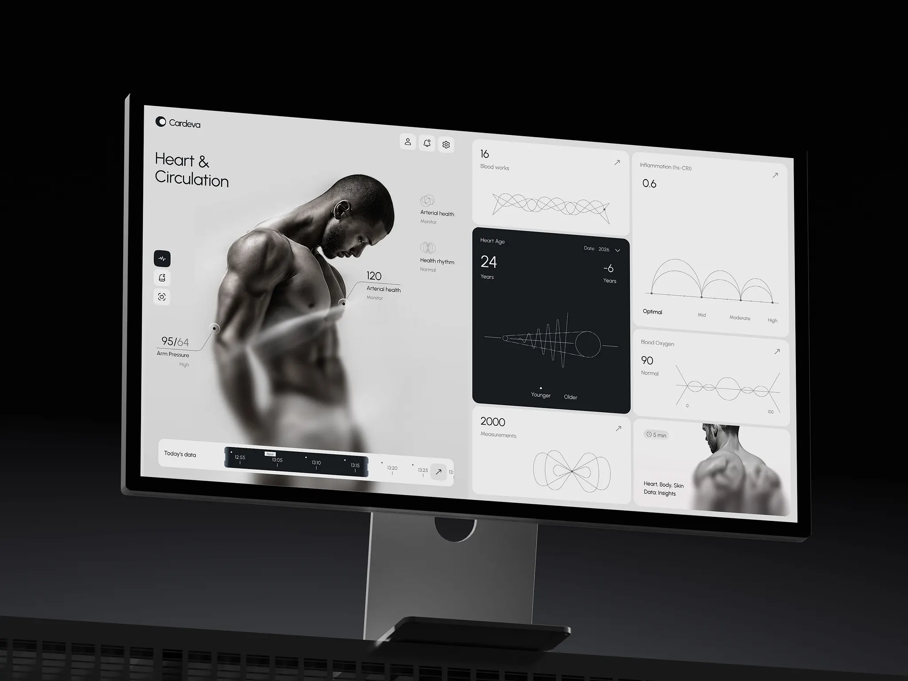
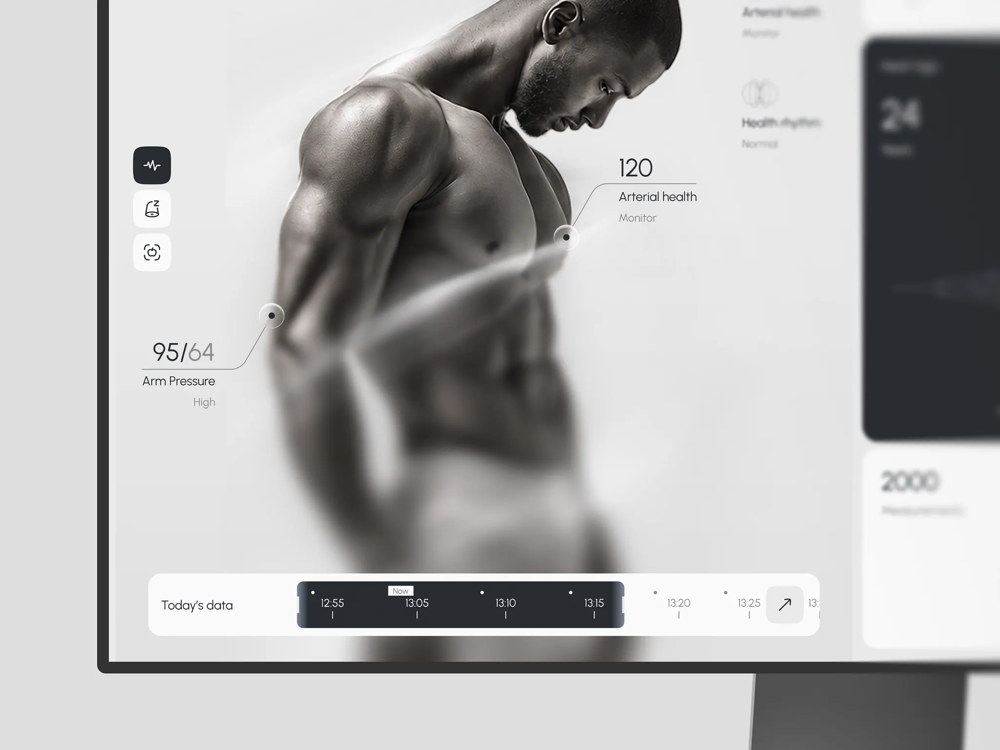

# Cardeva · 心血管健康仪表盘（Heart & Circulation）

| 产品名 | 链接 | 收录时间 | 产品场景 | 平台 | 标签 |
| --- | --- | --- | --- | --- | --- |
| Cardeva | 待补充（收到的链接与 FLOX 相同，已向 Cindy 确认正确的 Dribbble 链接） | 2026-10-26 | 健康医疗 | Web / 桌面（Dribbble 概念稿） | 仪表盘、健康数据、单色、人体标注、时间轴、Bento 卡片 |

> 说明：这是 Dribbble 上的概念设计稿，不是已上线产品。分析依据 Cindy 提供的两张截图；色值从截图取样，截图 01 是带灯光的显示器样机，整体偏暗，以截图 02 的取样为准。

## 素材





## 视觉风格总览

**一句话**：把医疗数据做成“时尚画册”。全屏只用黑、白、灰三种层次，一张高级感的黑白人体摄影占据左半屏，数据像杂志图注一样挂在身体上；右侧是一组浅灰 Bento 卡片，只有一张深色卡片作为视觉重心。图表全部是细线条的抽象几何，不像传统医疗软件的柱状图和红绿警示。

| 维度 | 特征 |
| --- | --- |
| 气质 | 冷静、高级、偏奢侈品/健身品牌，而不是医院系统 |
| 用色策略 | 纯单色。没有品牌色，也没有红黄绿语义色，状态全靠文字（High / Normal / Optimal）表达 |
| 形状语言 | 大圆角卡片（约 20–24px）、圆角方形图标按钮（约 12px）、细线条图表、圆形标注点 |
| 深度 | 几乎没有阴影，靠灰阶明度差区分层次；只有人体照片的景深虚化和标注点的柔光提供“立体感” |

## 字体

| 角色 | 字体 | 说明 |
| --- | --- | --- |
| 标题 / 展示 | 几何无衬线，疑似 **Urbanist / Outfit** 一类（截图推断，未确认） | “Heart & Circulation” 两行大标题，Light/Regular 字重，字距略紧 |
| 正文 / UI | 同一字体家族 | 卡片标签（Blood works、Heart Age）用 Regular 小字号 |
| 数字 | 同一字体家族，细字重 | 16、24、0.6、2000、95/64 等核心数值都是细字重大字，不加粗 |

- **字号阶梯**（按 1440 宽估算）：大标题 ≈ 36–40 / 核心数值 ≈ 24–28 / 标注数值 ≈ 22 / 标签 ≈ 12–13 / 辅助状态 ≈ 10–11。
- **字重与行高**：全局只用 Light 和 Regular 两档，没有 Bold。层级靠字号和灰度拉开。标题行高很紧（约 1.1）。
- **细节**：“95/64” 中舒张压“64”用浅灰，收缩压“95”用深灰，同一个数字内部也分主次。
- **启发**：数据型界面不一定要加粗数字。细字重大数字搭配大量留白，会显得更克制、更“高级”，适合面向消费者的健康产品。

## 层级结构

**页面结构层级**：

```
Cardeva
└─ 身体系统（左侧竖排图标切换：心血管 / 睡眠 / 体态扫描 …）
   └─ Heart & Circulation 心血管
      ├─ 人体主视觉 + 部位标注（Arm Pressure、Arterial health …）
      ├─ 指标概览（Arterial health、Health rhythm）
      ├─ 指标卡片（Blood works、Heart Age、Inflammation、Blood Oxygen、Measurements）
      ├─ 洞察入口（Heart, Body, Skin Data: Insights · 5 min）
      └─ Today's data 时间轴
```

**界面布局层级**（从外到内）：
1. 左半屏：Logo、大标题、竖排系统切换图标、人体照片（主视觉，也是背景）
2. 左上角右侧：账户 / 通知 / 设置三个图标按钮
3. 左下角：悬浮在照片上的时间轴条
4. 右半屏：2 列 Bento 卡片网格，卡片高度不等

**信息层级**（单张卡片）：
1. 核心数值（大号细字，左上）
2. 指标名（小号灰字，数值下方或上方）
3. 状态词（Normal / High，更浅的灰）
4. 抽象图表（占卡片下半部分）
5. 右上角 ↗ 跳转箭头

**层级手法**：明度反转（全屏只有 Heart Age 一张深色卡片，自然成为第一视觉焦点）、字号、灰度三级（近黑 / 中灰 / 浅灰）、位置（数值固定左上）。没有分割线，全靠卡片间距和底色差分组。

## 视觉要点

- **布局 / 栅格**：左右约 1 : 1 分屏。左边是“叙事区”（照片 + 标注），右边是“数据区”（Bento 网格）。照片没有被框进卡片，而是作为左半屏背景，时间轴卡片直接叠在照片上。
- **色彩**（截图 02 取样，近似值）：
  - 页面底：`#DEDEDE` – `#E5E5E5`
  - 浅色卡片 / 时间轴底：`#EEEEF0` – `#F2F2F2`
  - 深色卡片 / 时间轴选区 / 选中图标：`#292D32`（截图 01 中约 `#181C1F`）
  - 主文字：`#2C2C2C`；次要文字约 `#8A8A8A`；浅灰状态词约 `#B5B5B5`
  - 语义色：无
- **图标与插画**：线性图标，描边约 1.5px。指标用“螺旋 / 李萨如曲线 / 正弦叠加 / 拱形”这类抽象几何线条表示，更像装饰性的数据隐喻，而不是可读的精确图表。
- **质感**：大圆角、无投影、低对比灰阶；人体照片下半部分做了景深虚化，与界面底色融合；标注点是带柔光的白色圆环，像贴在皮肤上的传感器。

## 交互设计点

- **人体标注（Body callouts）**：数值通过“圆点 + 折线引线 + 横线 + 文字”挂在对应身体部位（手臂 → Arm Pressure 95/64，胸口 → Arterial health 120）。数据和身体部位直接对应，用户不用在图例和图表之间来回对照。截图中两条标注之间还有一道光带，暗示血液流动 / 测量路径。
- **时间轴拖选（Timeline scrubber）**：底部“Today's data”是一条横向刻度尺，每 5 分钟一个刻度。深色圆角矩形是可拖动的选区（12:55–13:15），两端有拖拽把手；“Now” 小标签标出当前时间；选区外的时间点变灰，最右侧的刻度被截断，暗示可以横向滚动。推测拖动选区会联动左侧标注和右侧卡片的数据。
- **深色高亮卡片**：Heart Age 是唯一的深色卡片，显示“心脏年龄 24 岁，比实际年龄小 6 岁”，并带年份下拉（Date 2026）和 Younger / Older 刻度。把最有“情绪价值”的结论做成视觉焦点。
- **箭头入口按钮**：每张卡片右上角都有 ↗，表示“展开详情”；时间轴末端也有一个 ↗ 方形按钮。统一的入口符号让整页的可点击区域一眼可辨。
- **系统切换**：左侧竖排的三个圆角图标，选中态是深色底白图标，未选中是浅色底深图标，和深色卡片、时间轴选区用的是同一套“深色 = 当前 / 重点”语言。
- **洞察入口**：右下角卡片用第二张人体照片 + “5 min” 时长标签，引导用户阅读一篇解读内容，类似健身 App 里的课程卡。
- **待商榷**：状态只用文字区分，High（偏高）和 Normal 在视觉上完全一样，异常值容易被忽略；抽象几何图表好看但读不出数值趋势。

## 演变时间线

> 这是 Dribbble 概念稿，没有可追溯的产品改版历史。后续如果收录到同一设计师或同一品牌的其他稿件，在这里追加。

| 时间 | 变化 | 类型（视觉 / 交互 / IA / 品牌） | 影响 |
| --- | --- | --- | --- |
| 2026-10 | 首次收录（概念稿） | — | — |

**演变规律**：暂无。

## 可借鉴 / 待商榷

- ✅ 可借鉴：
  - 用人体图 + 引线标注承载部位相关的数据，空间对应比图例直观。
  - 全屏灰阶中只留一处深色反转，作为天然的视觉焦点。
  - 时间轴用“深色选区 + Now 标签 + 截断刻度”同时表达范围、当前时刻和可滚动。
  - 统一的 ↗ 跳转符号。
  - 细字重大数字，克制而有质感。
- ⚠️ 待商榷：
  - 健康产品完全去掉语义色，异常值缺少警示，有可用性风险。
  - 抽象几何图表偏装饰，无法读出具体趋势或阈值。
  - 浅灰小字（状态词、刻度）对比度不足，可能达不到 WCAG AA。
  - 高度依赖专业摄影，换成真实用户数据或不同体型时，效果难以保证。

## 关联

- 归纳条目：见 [SUMMARY.md](../../../SUMMARY.md) 中的“深色反转焦点”“数据挂在实物上”“单色仪表盘”等规律，以及跨产品对比表中的仪表盘一列。
