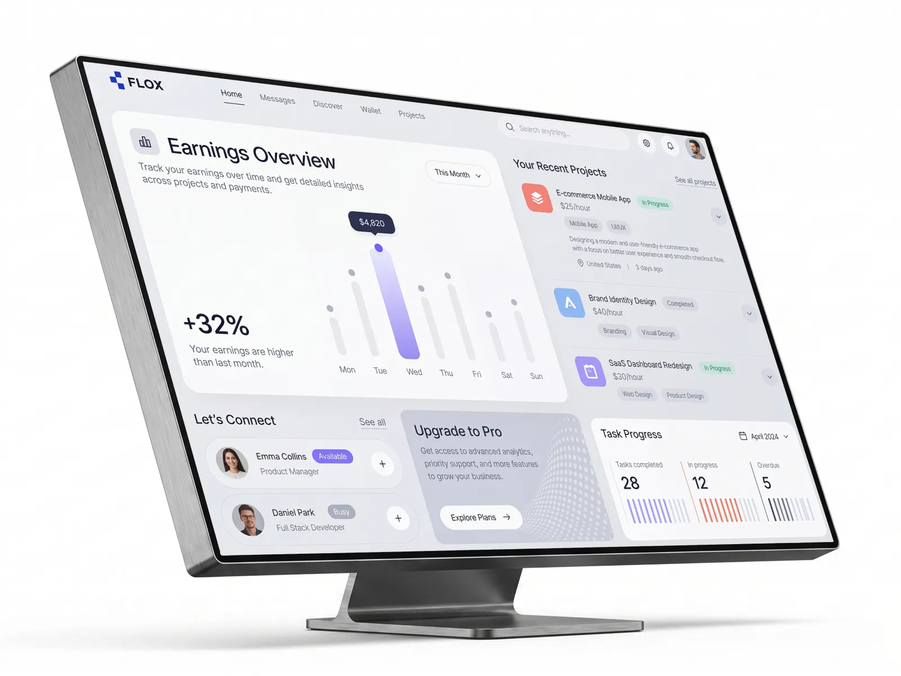
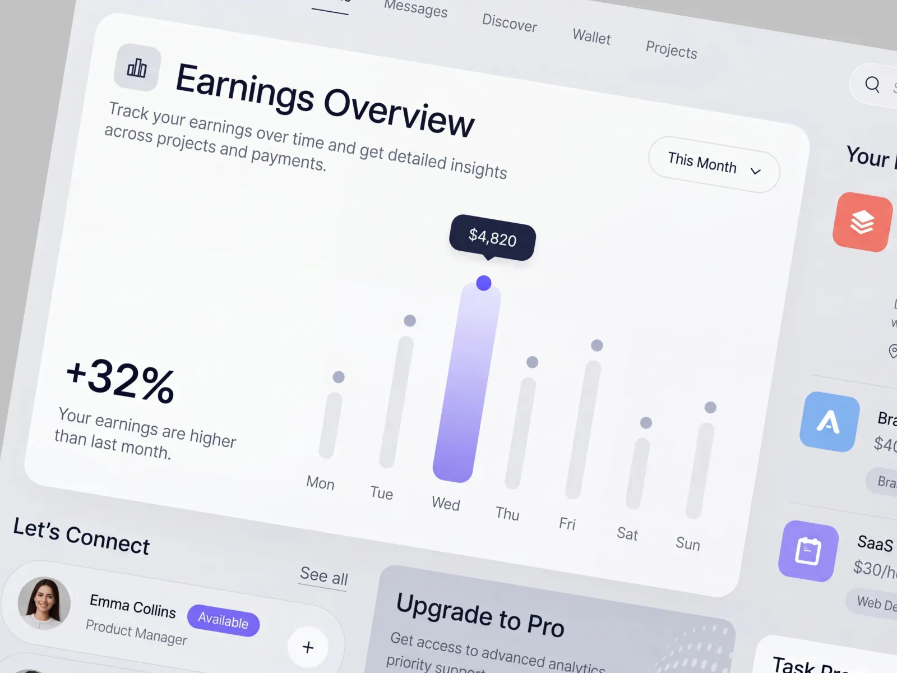

# FLOX · 自由职业者管理仪表盘（收入、项目、任务一屏总览）

| 产品名 | 链接 | 收录时间 | 产品场景 | 平台 | 标签 |
| --- | --- | --- | --- | --- | --- |
| FLOX（Dribbble 概念稿） | <https://dribbble.com/shots/27794184-Freelancer-Management-Dashboard-FLOX> | 2026-10-26 | SaaS 仪表盘 | Web / 桌面 | 仪表盘、Bento 卡片、柱状图、tooltip、状态标签、浅灰拟物、字体、层级结构 |

> 说明：这是 Dribbble 上的概念设计稿，不是已上线的产品。Dribbble 页面在当前网络环境下打不开，下面的分析完全依据 Cindy 提供的两张截图。色值是从截图取样的近似值（截图带透视、反光和压缩，误差约 ±5%）；字体和字号是目测推断，没有源文件验证。

## 素材





## 视觉风格总览

**一句话**：浅灰底上浮着几块近白色的大圆角卡片，整页几乎是黑白灰，只让一根“今天”的紫色渐变柱和少量彩色图标、状态标签负责吸引视线。是 2024 年以来 Dribbble 上很典型的“柔和 Bento 仪表盘”风格：留白多、圆角大、对比低，偏展示感。

| 维度 | 特征 |
| --- | --- |
| 气质 | 安静、精致、偏消费级。用大标题和大数字讲“结论”，而不是堆表格 |
| 用色策略 | 中性灰阶占 90% 以上；主强调色是蓝紫 `#665CFC`（只出现在选中柱、选中点和 Available 标签上）；项目图标用橙 / 蓝 / 紫三色做区分；状态用薄荷绿和灰 |
| 形状语言 | 大圆角卡片（约 24–28px）、胶囊形按钮和标签、圆形图标按钮、圆头柱状条；图标底板是约 12px 圆角的方块 |
| 深度 | 几乎不用描边，层次靠“灰底 vs. 近白卡片”的明度差，加上非常淡的大半径阴影；tooltip 是全页唯一的深色块，深度最高 |

## 字体

| 角色 | 字体（推测） | 说明 |
| --- | --- | --- |
| 标题 / 展示 | 几何感较弱的新怪诞无衬线，接近 **Inter Display / SF Pro Display** 一类 | “Earnings Overview” 用 Medium（约 500）而不是 Bold，字距略收紧，大而不重 |
| 正文 / UI | 同一字族的 Regular（400） | 描述、元信息、导航都用 Regular，靠灰度区分主次 |
| 数字 | 同字族，Medium，未见明显等宽设置 | “+32%”“$4,820”“28 / 12 / 5” 都放大处理，是页面上最显眼的元素之一 |

- **字号阶梯**（按 1440 宽画布估算）：页面主标题约 36px → 关键数字 +32% 约 44–48px → 区块标题（Your Recent Projects、Let’s Connect、Task Progress）约 20px → 任务统计数字约 26px → 卡片标题 / 人名约 15–16px → 描述正文约 14px → 元信息、标签、星期、导航约 12–13px → 状态标签约 11px。
- **字重与行高**：全页只用了 400 和 500 两档，没有 600/700。描述文本行高约 1.4，大标题约 1.1。
- **启发**：只用两档字重、靠**字号跨度 + 灰度**做层级，画面会显得很轻；代价是小字号的灰字（12px 浅灰元信息）对比度偏低，落地时需要校验可读性。

## 层级结构

**页面结构层级**（信息架构）：

```
FLOX
├─ Home（当前页：收入、项目、人脉、升级、任务）
├─ Messages
├─ Discover
├─ Wallet
└─ Projects
顶栏右侧：全局搜索 · 设置 · 通知 · 头像
```

**界面布局层级**（从外到内）：

```
顶栏：Logo ｜ 文本 Tab 导航（Home 下划线选中）｜ 搜索框 · 图标按钮 · 头像
主体：不等宽 Bento 网格
├─ 左上 大卡：Earnings Overview（约占 2/3 宽、2/3 高）
│   ├─ 图标底板 + 标题 + 描述 + 右上角 “This Month” 下拉
│   ├─ 左下：+32% 结论数字 + 解释
│   └─ 右侧：7 天柱状图 + 选中项 tooltip
├─ 右上 列：Your Recent Projects（无卡片底，直接放在灰底上的列表）
│   └─ 项目行 ×3：彩色图标 · 名称 · 状态标签 · 时薪 · 技能标签 · 展开箭头
│      （第一行为展开态，多出描述、地点、时间）
└─ 底部 三栏：Let’s Connect（人脉卡）｜ Upgrade to Pro（推广卡）｜ Task Progress（统计卡）
```

**信息层级**（以两个核心模块为例）：

- Earnings Overview：① 标题 → ② 结论数字 “+32%” → ③ 选中柱 + tooltip 金额 → ④ 其余灰柱 → ⑤ 描述和星期标签。先给结论，再给图表佐证。
- 项目行：① 彩色项目图标 → ② 项目名 → ③ 状态标签（In Progress / Completed）→ ④ 时薪 → ⑤ 技能标签 → ⑥ 展开后才出现的描述、地点、时间。

**层级手法**：
- **明度分层**：页面底 `#E6E8EC` → 卡片 `#F9FBFA` → 卡片内控件（胶囊按钮白底）→ 深色 tooltip。一共四层，每层只靠明度区分，几乎不用描边。
- **“单点高亮”**：图表里只有一根柱子是彩色渐变，其余六根都是 `#E5E7EB` 浅灰，眼睛直接落在“今天”。
- **字号跨度大**：36–48px 的标题和数字 vs. 12px 的元信息，跨度约 4 倍，弥补了只有两档字重的不足。
- **容器的有无也是层级**：最重要的收入模块有白卡片；项目列表反而没有卡片底，直接贴在灰底上，用细分割线分隔，弱化成“次要信息”。

## 视觉要点

- **布局 / 栅格**：不等宽 Bento 网格。左上大卡是视觉中心，右侧是一列长列表，底部三张卡片高度一致、宽度相近。卡片间距约 16–20px，卡片内边距约 32px，留白很足。
- **色彩**（截图取样，近似值）：

  | 用途 | 色值 |
  | --- | --- |
  | 页面底色 | `#E6E8EC` |
  | 卡片底色 | `#F9FBFA` |
  | 标题文字（近黑偏蓝紫） | `#121126` |
  | 次级文字（星期、描述） | `#4C4E54` |
  | 未选中柱 / 未选中点 | `#E5E7EB` / `#ACB1CA` |
  | 主强调（选中点、Available） | `#665CFC` / `#7969F5` |
  | 选中柱渐变 | 顶 `#DEDBFE` → 底 `#9B90F1` |
  | tooltip 底色 | `#212642` |
  | 项目图标：橙 / 蓝 / 紫 | `#F0776B` / `#83B3EE` / `#9D8EF5` |
  | In Progress 标签：底 / 字 | `#C6E5DD` / 深薄荷绿（字太小，无法精确取样） |
  | Busy 标签 | `#C9CBD8` |
  | Task Progress 条纹：紫 / 红 / 深灰 | `#A89CF5` / `#DE816E` / `#3A3C3D` |
  | Upgrade 卡底色 | `#C6C9D6` |
  | Logo 蓝 | `#1735CF` |

- **图标与插画**：线性图标（搜索、设置、通知、日历、地点），线宽约 1.5px，很细。项目图标是“彩色圆角方块 + 白色线性图形”，像 App 图标。Upgrade 卡用一张灰色的波点曲面 3D 纹理做背景，是全页唯一的装饰图形。
- **质感**：大圆角 + 柔和阴影 + 白色胶囊按钮（`This Month`、`Explore Plans`、`+`）带极浅的阴影，像浮在卡片上的小药丸。整体是“低对比的新拟物”，但比 2020 年的 Neumorphism 克制，没有内凹效果。
- **数据可视化**：
  - 柱状图用**圆头细柱 + 柱顶小圆点**，像“棒棒糖图”，选中柱变宽、变色、加渐变。
  - Task Progress 用**竖条纹进度条**：彩色条数 = 已完成比例，剩下的是浅灰条，用颜色区分 Completed（紫）、In progress（红橙）、Overdue（深灰）。它把“比例”变成可数的条纹，比一根进度条更有质感。

## 交互设计点

- **核心流程**：落地页先回答“这个月赚了多少、比上月好不好”（Earnings），再列出“手上有哪些项目”（Recent Projects），然后是“任务完成得怎么样”（Task Progress）。人脉和升级推广放在底部次要位置。
- **图表 tooltip**：选中某一天时，柱子变成紫色渐变、顶部点变实心紫，上方弹出深色 tooltip 显示金额。tooltip 带小三角指向数据点，颜色和全页反差最大，阅读路径很短。推测 hover 或点击触发；默认选中“今天”或最高值，保证首屏就有焦点。
- **时间范围下拉**：Earnings 右上角 “This Month ⌄”，Task Progress 右上角 “📅 April 2024 ⌄”。两个模块各自有时间筛选，而不是全页一个全局时间选择器。好处是各看各的，缺点是两个模块的时间口径可能不一致。
- **状态标签**：
  - 项目状态：In Progress（薄荷绿底 + 绿字）、Completed（灰底 + 灰字）。“已完成”被刻意弱化，进行中的更显眼。
  - 人员状态：Available（实心紫底 + 白字）、Busy（灰底 + 白字）。可联系的人用主色强调，忙的人降级。
  - 规律：**能行动的状态用彩色，不能行动 / 已结束的状态用灰**。
- **展开 / 收起**：每个项目行右侧有圆形 “⌄” 按钮。第一行是展开态，多出项目描述、地点（United States）和时间（3 days ago）。列表默认只露关键信息，细节按需展开。
- **快捷添加**：人脉卡右侧圆形 “+” 按钮，一步加好友或发起合作；“See all / See all projects” 用带下划线的文本链接。
- **推广卡**：“Upgrade to Pro” 用比白卡更深的灰底 + 3D 纹理和其他卡区分，CTA 是白色胶囊 “Explore Plans →”。不用高饱和色做推广，避免破坏整体安静的气质。
- **导航反馈**：顶部 Tab 当前项用**黑字 + 下划线**，其余是灰字，没有底色块。
- **细节惊喜**：选中柱子既变色又变宽，tooltip 的深色和白底形成全页最强对比，单点聚焦做得很干净。

## 演变时间线

> FLOX 是 Dribbble 上的概念稿，没有历史版本可查。后续如果收录到同一团队的其他作品或这个概念的落地版本，在这里追加。

| 时间 | 变化 | 类型（视觉 / 交互 / IA / 品牌） | 影响 |
| --- | --- | --- | --- |
| 2026-10（收录） | 概念稿首次发布 | 视觉 / 交互 | — |

**演变规律**：单一时间点，暂无。放到行业里看，它代表的是 SaaS 仪表盘“从表格驱动到结论驱动”的一个典型样本，见 [SUMMARY.md](../../../SUMMARY.md) 的“演变与对比”。

## 可借鉴 / 待商榷

- ✅ 可借鉴：**先给结论再给图**。“+32% Your earnings are higher than last month” 一句话说清楚，比只放图表更容易读。
- ✅ 可借鉴：**图表只高亮一项**，其余灰掉，焦点非常清楚。
- ✅ 可借鉴：**状态色按“能否行动”分配**：可行动的彩色，已结束 / 不可用的灰色。
- ✅ 可借鉴：**条纹进度条**，把比例变成可数的条，既是数据又是装饰。
- ✅ 可借鉴：推广卡用“更深的中性灰 + 纹理”区分，而不是用刺眼的强调色。
- ⚠️ 待商榷：整体对比度偏低。浅灰底上的浅灰小字（元信息、技能标签、星期）在真实屏幕上可能达不到 WCAG AA 4.5:1。
- ⚠️ 待商榷：柱状图没有 Y 轴和刻度，只有选中项显示金额，无法直接比较其他几天的数值；作为展示稿可以，作为真实工具要补 hover 和轴。
- ⚠️ 待商榷：两个模块各自的时间筛选（This Month / April 2024）口径不统一，用户切换时容易误读。
- ⚠️ 待商榷：“Completed” 和 “Busy” 的灰色标签文字对比度很低，几乎读不清。

## 关联

- 对比条目：[Miro 团队仪表盘](../2026-10-23-Miro/README.md)（同为“仪表盘”，一个是工具型内容列表，一个是数据概览型）
- 归纳条目：见 [SUMMARY.md](../../../SUMMARY.md) 中的“布局与栅格”“色彩”“字体与信息层级”“反馈与状态”“演变与对比”
