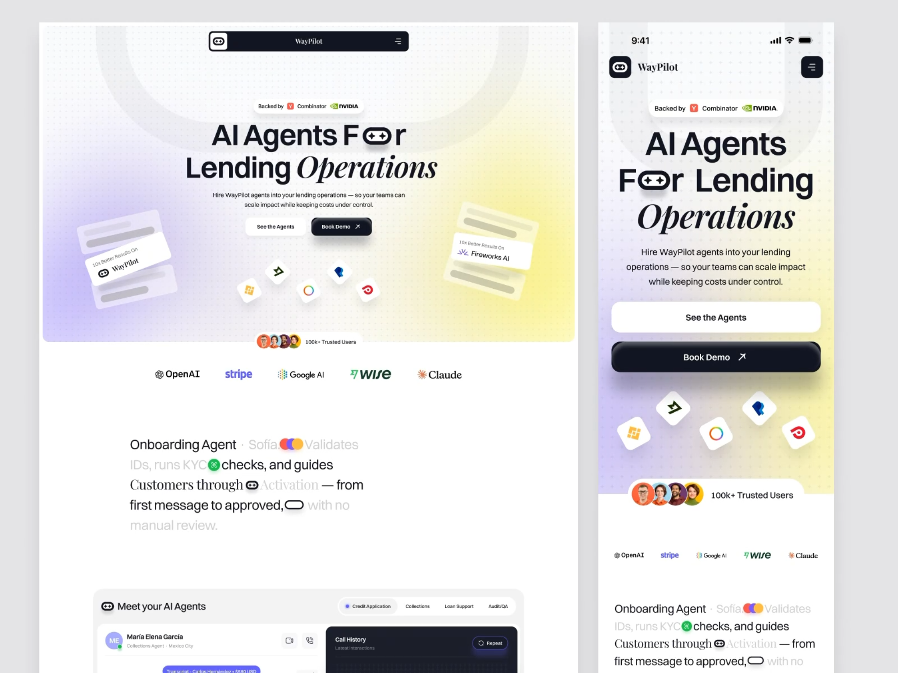
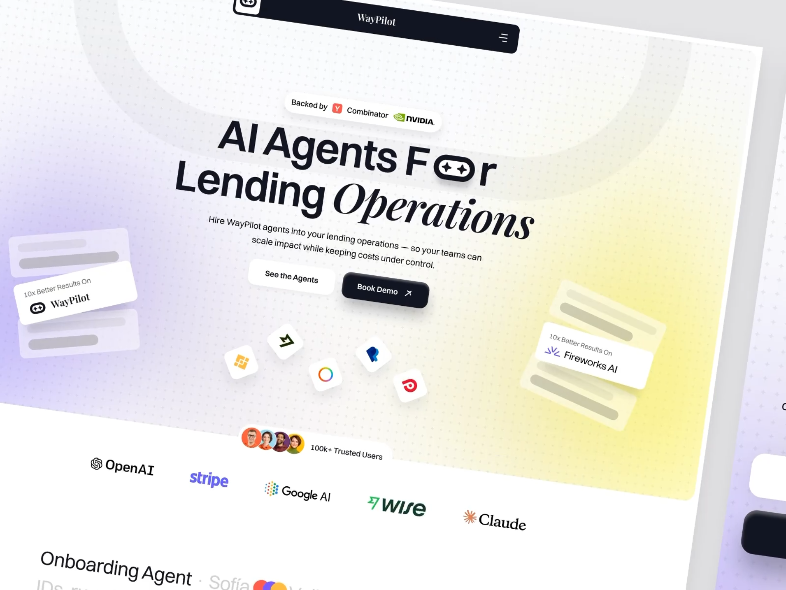
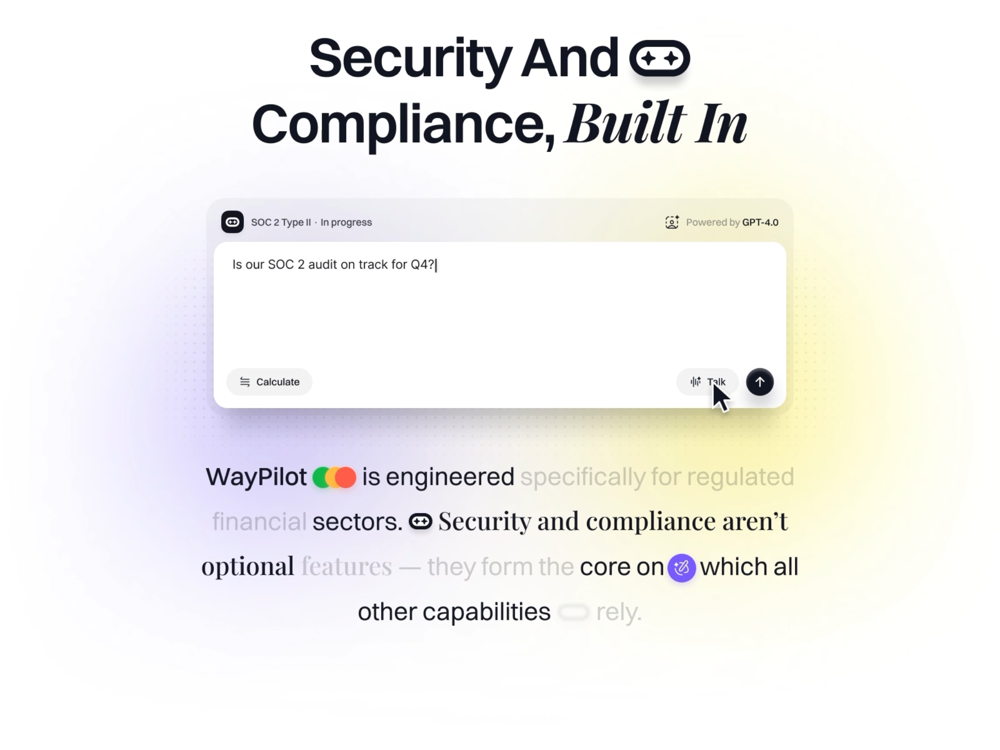

# WayPilot · AI 金融 SaaS 官网（贷款运营 AI Agent 落地页）

| 产品名 | 链接 | 收录时间 | 产品场景 | 平台 | 标签 |
| --- | --- | --- | --- | --- | --- |
| WayPilot（Dribbble 概念稿） | <https://dribbble.com/shots/27829394-AI-FinTech-SaaS-Website-UI-UX-Design> | 2026-10-26 | 官网落地页 | Web 桌面 + 移动端 | 官网、Hero、无衬线 + 斜体衬线混排、行内图标、渐变光晕、点阵底纹、滚动高亮文字、AI 输入框、响应式 |

> 说明：这是 Dribbble 上的概念设计稿，不是已上线的产品。Dribbble 页面在当前网络环境下打不开，分析完全依据 Cindy 提供的三张截图（桌面 + 移动端并排、桌面 Hero 透视特写、安全合规区块特写）。色值是从截图取样的近似值，光晕区域是渐变，取的是代表点；字体和字号是目测推断。动效部分是根据静态画面里的“半亮半灰”状态推断的，没有看到原视频。

## 素材







## 视觉风格总览

**一句话**：白底 + 细点阵，左下紫、右下黄两团大面积柔光托住居中的大标题；标题用粗无衬线和斜体衬线混排，再把品牌 Logo（一个“游戏手柄”形胶囊）直接塞进单词里当字母用。整体是 2025–2026 年 AI 创业公司官网的典型“柔光 + 编辑感排版”路线，用衬线斜体给“金融科技”加一点可信、高级的杂志气质。

| 维度 | 特征 |
| --- | --- |
| 气质 | 友好、轻盈、带一点编辑 / 杂志感；不是传统金融的深蓝严肃风，而是 AI 产品的“明亮未来感” |
| 用色策略 | 主体黑白；紫 `#D4CCF8` 与黄 `#F8F1A0` 两色光晕只做背景氛围，不承担交互语义；交互主色是近黑 `#111522`（导航条、主按钮、发送按钮）；第三方 Logo 自带彩色，作为点缀 |
| 形状语言 | 胶囊为母题：Logo 是胶囊里两颗星（像手柄），导航条、按钮、“Backed by”徽标、头像组标签都是胶囊或大圆角；浮动的 App 图标是倾斜的圆角方块 |
| 深度 | 靠柔和投影和“浮起来”的卡片制造空间：主按钮和导航条带明显的黑色柔影，浮动卡片层叠 + 半透明骨架条，背景还有一个超大的浅灰“U”形描边做景深 |

## 字体

| 角色 | 字体（推测） | 说明 |
| --- | --- | --- |
| 标题 / 展示 | 粗体新怪诞无衬线，接近 **Inter Tight / SF Pro Display Semibold** | “AI Agents For Lending” 用约 600–700 字重，字距明显收紧（约 -3%），行高很紧（约 1.0） |
| 强调词 | 高对比斜体衬线，接近 **Playfair Display Italic / Instrument Serif Italic** | 每个大标题的最后一个关键词（Operations、Built In）换成斜体衬线，形成“理性 + 感性”的对照 |
| Logo 字 | 直立衬线（同一衬线家族 Regular） | 导航里的 “WayPilot” 和浮动卡片里的品牌名都是衬线体，品牌识别和强调词呼应 |
| 正文 / UI | 同一无衬线 Regular / Medium | 副标题、按钮、Logo 墙、输入框文字 |

- **字号阶梯**（按 1440 宽画布估算）：Hero 大标题约 72–80px → 区块标题（Security And Compliance）约 64px → 叙事段落（滚动高亮文字）约 32–36px → 副标题约 16px → 按钮约 14px → “Backed by” 徽标、浮动卡片小字约 11–12px。移动端大标题约 48px（相对屏宽反而更大），按钮约 16px。
- **字重与行高**：标题 600–700 + 衬线斜体 400，正文 400，按钮 500。大标题行高约 1.0，叙事段落行高约 1.6（为行内图标留出空间）。
- **行内图标（icon-in-headline）**：把 Logo 胶囊放进 “F⬭r” 替代字母 o，把“三色圆点”“KYC 绿勾”“紫色魔法棒”“空胶囊”等小图标插在叙事段落的单词之间，图标高度约等于大写字母高度（cap height），基线对齐。效果是“文字即插图”，读起来像在看一段带表情的句子。
- **混排规则也用在段落里**：叙事段落中，“Security and compliance aren’t optional” 这一句整句换成衬线体（直立），其余是无衬线，用字体切换标出“核心论点”。
- **启发**：无衬线 + 斜体衬线的“一句一词”混排，是用最低成本给产品加品牌个性的办法；关键是**只换最后一个关键词**，并且全站规则一致。行内图标适合品牌 Logo 这种简洁的形状，复杂图标放进字里会显得乱。

## 层级结构

**页面结构层级**（从截图可见的区块顺序）：

```
WayPilot 官网
├─ 顶部导航：胶囊形深色导航条（Logo · 品牌名 · 汉堡菜单）
├─ Hero：背书徽标 → 大标题 → 副标题 → 双按钮 → 浮动图标群 / 两侧浮动卡片
├─ 社会证明：头像组 “100k+ Trusted Users” + 合作方 Logo 墙（OpenAI、Stripe、Google AI、Wise、Claude）
├─ Agent 介绍叙事段落（Onboarding Agent · Sofía …，滚动高亮）
├─ Meet your AI Agents：按业务分 Tab（Credit Application / Collections / Loan Support / Audit/QA）+ 人员卡片 + 深色 Call History 面板
└─ Security And Compliance, Built In：AI 输入框演示 + 叙事段落
```

**Hero 的布局层级**（从外到内）：

```
背景层：白底 → 点阵 → 紫/黄光晕 → 超大浅灰 “U” 形描边
装饰层：左右两组倾斜浮动卡片（“10x Better Results On WayPilot / Fireworks AI” + 骨架条）
        中下方 5 个倾斜的第三方 App 图标
内容层（居中单列）：Backed by 徽标 → H1 → 副标题 → [See the Agents] [Book Demo ↗]
底边：头像组标签骑在 Hero 卡片的下边缘上，连接下一屏
```

**信息层级**：

- Hero：① 大标题（尤其斜体 Operations）→ ② 主按钮 Book Demo（深色，带投影）→ ③ 背书徽标（Y Combinator / NVIDIA）→ ④ 副标题 → ⑤ 次按钮 See the Agents → ⑥ 浮动装饰。
- 叙事段落：① 已“点亮”的深色词 → ② 行内彩色图标 → ③ 未点亮的浅灰词。阅读顺序被滚动进度控制。
- AI 输入框：① 用户提问 → ② 发送按钮（深色圆形）→ ③ 顶部状态 “SOC 2 Type II · In progress” → ④ “Powered by GPT-4.0” → ⑤ Calculate / Talk 工具按钮。

**层级手法**：
- **字体切换代替加粗**：最重要的词不是更粗，而是换成斜体衬线。
- **黑白两极做行动层级**：主按钮近黑实心 + 投影，次按钮纯白 + 极淡投影，对比非常直接。
- **灰度 = 阅读进度**：叙事段落用深色 `#13151E` 和浅灰（约 `#C9CBD1`）两档，表达“已读 / 未读”。
- **背书前置**：“Backed by Y Combinator · NVIDIA” 放在标题**上方**而不是页脚，金融产品先解决信任问题。
- **装饰物倾斜、内容物水平**：浮动卡片和图标全部带随机旋转角度，文字和按钮严格水平居中，一眼区分“装饰”和“信息”。

## 视觉要点

- **布局 / 栅格**：Hero 是居中单列，内容宽度约 560–640px，两侧留给浮动装饰。Hero 本身是一张大圆角（约 24px）的卡片，四周露出页面浅灰底 `#E4E4E6`，下方内容区回到纯白 `#FFFFFF`。后续区块（Agent 叙事段落）改为左对齐窄栏，节奏从“居中展示”切到“阅读”。
- **色彩**：
  - 文字 / 主按钮 / 导航条：`#111522` – `#13151E`（带一点蓝的近黑）
  - 光晕紫：约 `#D4CCF8`（中心）→ 白；光晕黄：约 `#F8F1A0`（中心）→ 白
  - Hero 中部底色：`#F7F5F5`；输入框外框：`#F1F0F3`；内容区：`#FFFFFF`
  - 未点亮文字：约 `#C9CBD1`；行内强调图标：紫约 `#7C5CF5`、绿约 `#22C55E`
- **点阵底纹**：约 16px 间距的浅灰小点铺满 Hero 和输入框周围，像方格纸，暗示“精确 / 工程感”，同时让大面积留白不显得空。
- **图标与插画**：没有插画，用“真实感物件”代替：第三方 App 图标（像 Binance、Robinhood、PayPal 风格的方块图标）倾斜漂浮，暗示“能接入你现有的工具”；骨架条卡片暗示“数据报告”。
- **质感**：大面积柔光 + 柔影 + 白卡，干净但有体积感；主按钮投影偏重（黑色、约 20px 模糊、向下偏移），让它像一块“实体按键”。

## 交互设计点

- **核心流程**：Hero 双 CTA 分流两类访客：想了解的人点 See the Agents（滚动到 Agent 介绍），准备采购的人点 Book Demo ↗（↗ 暗示跳出到预约页）。
- **滚动高亮文字（scroll-reveal text highlighting）**：叙事段落初始全是浅灰，随滚动逐词变深，行内图标也从浅灰描边态变成彩色实心态（截图里 “rely” 前的空胶囊还没点亮）。把“读一段营销文案”变成跟着滚动推进的小动画，既控制阅读节奏，又避免大段文字让人跳过。推测实现是 GSAP ScrollTrigger / Framer Motion 按词拆分、根据滚动进度插值颜色。
- **浮动卡片与图标**：Hero 两侧的卡片、底部的 App 图标都带旋转角度，推测有缓慢的漂浮 / 视差动效（鼠标移动或滚动时轻微位移），让首屏有“活着”的感觉。
- **AI 输入框做产品演示**：安全合规区块没有用截图或图表，而是放一个“正在输入”的对话框（光标闪烁 “Is our SOC 2 audit on track for Q4?|”），鼠标指针悬停在 Talk 上。访客直接看到“用自然语言问合规问题”这个核心体验。框顶部的状态行（SOC 2 Type II · In progress / Powered by GPT-4.0）同时完成了信任背书。
- **Tab 分业务场景**：Meet your AI Agents 用胶囊 Tab（Credit Application / Collections / Loan Support / Audit/QA）切换不同 Agent 的演示，选中项前有蓝紫小圆点。
- **响应式（桌面 → 移动）**：
  - 导航：桌面是居中的悬浮胶囊深色导航条；移动端拆开成左侧 Logo + 品牌名、右侧单独的深色方形汉堡按钮，背景透明。
  - 标题：断行重排为 4 行（AI Agents / F⬭r Lending / Operations），行内 Logo 图标保留，斜体词独占一行，反而更醒目。
  - 按钮：从并排的两个小按钮变成上下堆叠的通栏大按钮（高度约 52px），次按钮在上、主按钮在下，主按钮更靠近拇指区。
  - 装饰：两侧浮动卡片被去掉，只保留 App 图标群，并放大、拉开间距。
  - 光晕：桌面左紫右黄横向分布，移动端改为左下紫、右上黄，仍然保持对角关系。
  - Logo 墙：从桌面的宽间距一行，压缩成移动端的小字号一行，没有改成滚动或换行。
- **细节惊喜**：头像组标签“骑”在 Hero 卡片的下边缘，一半在渐变里一半在白底上，自然把视线引到下一屏的 Logo 墙。

## 演变时间线

| 时间 | 变化 | 类型（视觉 / 交互 / IA / 品牌） | 影响 |
| --- | --- | --- | --- |
| 2026-10 | Dribbble 概念稿，单一时间点 | — | 暂无演变 |

**演变规律**：暂无（概念稿）。

## 可借鉴 / 待商榷

- ✅ 可借鉴：
  - 无衬线 + 斜体衬线“只换最后一个关键词”，低成本建立品牌语气。
  - 品牌 Logo 嵌入标题当字母用，让 Logo 在首屏出现两次但不显得重复。
  - 滚动逐词高亮，把长文案变成有节奏的叙事；行内小图标同步点亮。
  - 用“正在输入的 AI 对话框”代替功能截图，直接演示核心交互。
  - 背书徽标放在标题上方，适合需要信任的金融 / 企业产品。
  - 移动端按钮通栏堆叠、主按钮放在下方靠近拇指。
- ⚠️ 待商榷：
  - 滚动高亮期间未点亮的浅灰字对比度很低，不滚动的人（或开启“减少动态效果”的人）读不清，需要提供静态全亮的兜底。
  - 行内图标对屏幕阅读器不友好，需要 `aria-hidden` 或替代文字，否则 “F⬭r” 会被读成 “F r”。
  - 紫黄光晕与 Logo 墙上各品牌的彩色叠在一起，Hero 底部略显杂。
  - 浮动卡片里的骨架条是纯装饰，在信任导向的金融官网里可能显得“空”，不如放真实数据片段。
  - 移动端 Logo 墙字号很小，几乎不可读。

## 关联

- 归纳条目：见 [SUMMARY.md](../../../SUMMARY.md) 中的“字体与信息层级”“动效与转场”“跨产品对比”
- 同批对比：[FLOX](../2026-10-26-FLOX/README.md)（同样以蓝紫为强调，但 FLOX 是产品内仪表盘，WayPilot 是营销官网）
