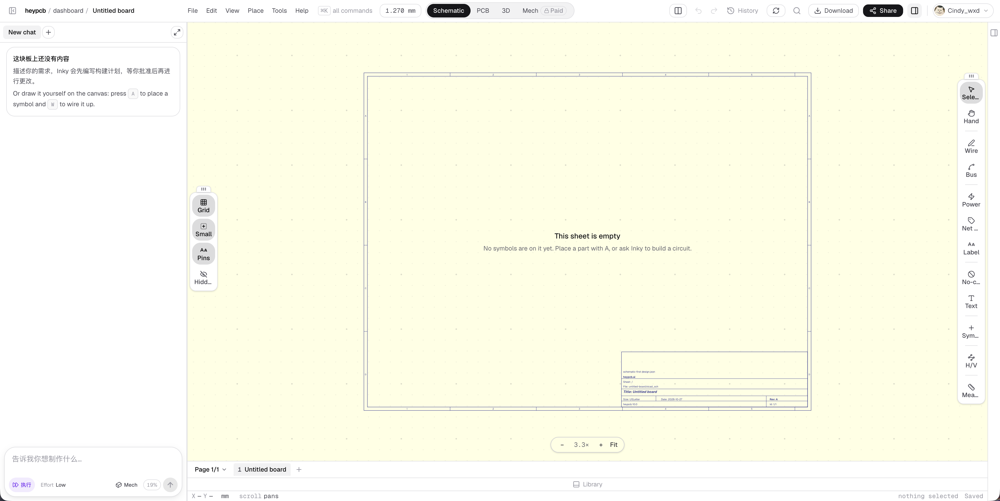

# heypcb · AI PCB 编辑器（对话面板 + KiCad 图纸画布）

| 产品名 | 链接 | 收录时间 | 产品场景 | 平台 | 标签 |
| --- | --- | --- | --- | --- | --- |
| heypcb（Inky 设计 Agent） | <https://heypcb.ai/> | 2026-10-27 | 开发工具 | Web 桌面 | AI Agent、专业编辑器、画布、对话面板、空状态、视图切换、浮动工具栏、快捷键引导、付费墙 |

> 说明：分析对象是 heypcb 的**产品编辑器**，不是官网。heypcb.ai 在当前网络环境下打不开，编辑器也需要登录，界面分析完全依据 Cindy 提供的一张截图（新建空白板子的原理图视图）。色值是从截图取样的近似值，字体是目测推断。产品定位、商业模式和技术逻辑见 Cindy 已完成的竞品报告：[heypcb.ai 竞品深度分析](https://cinnnnnnndy.github.io/BMC/heypcb-analysis/report.html)，本条只摘要与界面相关的部分。

## 素材

## 产品一句话

用自然语言描述一块电路板，AI Agent（Inky）生成原理图、PCB 布局和生产文件，交付的是**用户自己保留的 KiCad 工程文件**（Gerber / STEP / BOM），而不是一张渲染图。口号是 “Build something real.” 和 “Files you keep.”。（来源：官网首页与 Cindy 的竞品报告）

## 视觉风格总览

**一句话**：外壳是 2025–2026 年 AI 编辑器的标准“白色极简 + 黑色主按钮”（像 Cursor / v0 / Figma Make），中间画布却原样保留了 EDA 工程图纸的语言：淡黄底、深蓝图框、分区坐标、右下角标题栏。**外壳现代、画布传统**，让工程师一眼认出“这是真的 KiCad 图纸”，正好对应官网的 “Build something real”。

| 维度 | 特征 |
| --- | --- |
| 气质 | 冷静、工具感、可信；不做炫技装饰，唯一的“味道”来自图纸本身 |
| 用色策略 | 外壳纯白 + 浅灰分层 + 近黑主色（Share 按钮、选中的 Schematic 标签）；画布用 KiCad 经典的淡黄 `#FFFFE5` + 深蓝图框 `#414490`；AI 相关只用一点淡紫（“执行”芯片）；整屏几乎没有其他彩色 |
| 形状语言 | 胶囊是主母题：视图切换、单位、缩放、“执行 / Effort / Mech”芯片、Paid 徽标都是胶囊；浮动工具栏是大圆角竖条，按钮是圆角方块（图标在上、文字在下） |
| 深度（阴影 / 描边 / 材质） | 1px 浅灰描边分区（`#E0E0E3`），浮动工具栏和缩放条用描边 + 极淡投影浮在画布上；没有渐变和材质 |

## 字体

| 角色 | 字体（推测） | 说明 |
| --- | --- | --- |
| 标题 / 展示 | 无衬线 Semibold，接近 **Inter / SF Pro** | 面包屑里的 “Untitled board”、空状态标题 “This sheet is empty” |
| 正文 / UI | 同一无衬线 Regular / Medium，中文回退到 **PingFang SC** | 菜单、按钮、对话面板说明文字 |
| 数字 / 等宽 | 等宽字体，接近 **JetBrains Mono / Geist Mono** | 网格单位 `1.270 mm`、缩放 `3.3×`、底部状态栏 `X — Y — mm  scroll pans`、`nothing selected  Saved`、快捷键键帽 `A` `W` `⌘K` |
| 图纸内文字 | KiCad 默认笔画字体（深蓝、斜体） | 标题栏 “Title: Untitled board”、Size / Date / Rev，保持与 KiCad 导出一致 |

- **字号阶梯**（按 2000px 宽截图估算）：面包屑 / 菜单 / 按钮约 13–14px → 空状态标题约 15–16px → 说明文字约 13px → 工具栏图标下的标签约 12px → 状态栏、键帽约 11–12px。整体字号差很小，是典型的高密度工具界面。
- **字重与行高**：只用 400 / 500 / 600 三档；标题 600，按钮 500，其余 400。对话面板说明文字行高约 1.6，比菜单区宽松，读起来像一段提示而不是控件。
- **等宽字体标出“工程数值”**：凡是会变化的测量值、坐标和状态都用等宽体，和普通 UI 文字明显区分，也让数字跳动时不抖动。
- **启发**：专业工具可以用“无衬线 = 界面，等宽 = 数据 / 状态，图纸字体 = 产出物”三种字体分出三层身份。

## 层级结构

- **页面结构层级**（信息架构）：heypcb → dashboard → 某块板子（面包屑）；板子内部再分 **视图**（Schematic / PCB / 3D / Mech）→ **页**（Page 1/1，可加多页）→ 图纸上的元件和网络。官网与报告显示还有 Circuit World（11,000+ 开源板子）和 Explore 作为外部内容入口。
- **界面布局层级**（从外到内）：
  1. 顶栏：左边面包屑 + 菜单（File / Edit / View / Place / Tools / Help）+ ⌘K 命令搜索 + 网格单位；中间视图切换；右边历史、同步、搜索、Download、Share、右侧面板开关、账户。
  2. 左侧 AI 对话面板（约 360px，可展开为全屏）：顶部会话标签 “New chat” + “+”；中间消息区；底部输入框和模式芯片。
  3. 中间画布：淡黄底 + 点阵网格，上面是一张 US Letter 图纸。
  4. 画布上的浮动层：左侧“显示”工具栏（Grid / Small / Pins / Hidden），右侧“绘制”工具栏（Select / Hand / Wire / Bus / Power / Net / Label / No-connect / Text / Symbol / H/V / Measure），底部中间缩放条（− 3.3× + Fit）。
  5. 底部：页签栏（Page 1/1、页名、“+”）+ 中间可上拉的 Library 抽屉 + 最底一行等宽状态栏。
  6. 最右边缘：收起的属性面板开关。
- **信息层级**（单个区域内）：对话空状态卡片是“粗体标题（这块板上还没有内容）→ AI 路径说明 → 手动路径说明（带键帽）”；画布空状态是“标题 → 一句话说明两种做法”。状态栏是“坐标 → 单位 → 操作提示 ……（右对齐）选择状态 → 保存状态”。
- **层级手法**：
  - **黑色只给一个“当前”和一个“主操作”**：选中的视图标签（Schematic）和 Share 按钮是全屏仅有的两块近黑色；其他按钮都是白底描边或纯文字。
  - **工具按“作用对象”分边放**：左边工具栏只改“怎么看”（网格、尺寸、引脚、隐藏项），右边工具栏才是“画什么”，避免查看开关和绘制工具混在一起。
  - **描边分区，不用底色分区**：顶栏、对话面板、底栏都是白色，只靠 1px 浅灰线分开，把颜色留给画布。
  - **浮动工具栏用顶部的 ⋮⋮ 拖拽把手**暗示“这一层可以挪开”，与固定的外壳区分。

## 视觉要点

- **布局 / 栅格**：AI 对话在左、画布居中、属性面板在右（默认收起）。这是 Cursor、v0、Figma Make 一类“AI 优先”编辑器的布局，和传统 EDA（左工程树、右属性、顶部大工具条）不同：heypcb 把“对话”放在了原来“工程树”的位置。
- **色彩**（截图取样，近似值）：
  - 外壳底 `#FFFFFF`，分割线 `#E0E0E3`，视图切换底 `#F2F2F3`，选中工具 / 选中开关底 `#DCDCDD`
  - 主色近黑 `#17171A`（Share 按钮、选中视图），官网 theme-color 为 `#0A0A0C`，两者一致
  - 画布底 `#FFFFE5`（KiCad 经典原理图淡黄），图框线 `#414490`（深靛蓝），网格点浅灰
  - AI 模式“执行”芯片：淡紫底 `#E9E0FC` + 紫色文字 / 图标，是全屏唯一的彩色，专门标记“AI 在行动”
  - 禁用的撤销 / 重做和 Paid 徽标用 `#E2E2E4` 一类的浅灰
- **图标与插画**：线性图标，线宽约 1.5px，全部单色；工具栏是“图标 + 文字标签”的竖排按钮，降低专业工具的学习门槛。完全没有插画，空状态也只有文字。
- **质感（圆角、阴影、材质、留白）**：胶囊（视图切换、缩放、芯片）+ 约 12px 圆角（对话卡片、输入框、浮动工具栏）；阴影极淡；画布四周留了大量空白，图纸像一张纸放在桌面上。

## 交互设计点

- **核心流程**：描述需求 → Inky **先写构建计划，等你批准后才改动**（对话空状态原文）→ Agent 放置元件、连线、铺铜、跑检查 → 在 Schematic / PCB / 3D 之间切换核对 → Download 导出 KiCad / Gerber / STEP / BOM，或 Share 给协作者。“先计划、后批准”把 AI 的动作变成一个可审核的步骤，适合改动成本高的工程文件。
- **AI 路径和手动路径并列教学**：两个空状态都同时写了两条路：“问 Inky”和“按 A 放置元件、按 W 连线”。新手可以说话，老手可以直接动手，快捷键用键帽样式直接写在句子里。
- **Agent 控制项放在输入框里**：输入框下方是“执行”（模式，推测与“计划”可切换）、`Effort Low`（Agent 每轮做多少工作，也是计费档位）、`Mech`（是否涉及机械 / 外壳）、`19%`（推测为额度或上下文用量）。用户在发送前就能看到“这次会花多少”。
- **反馈与状态**：
  - 空状态分两处：对话面板一张卡片、图纸中心一段文字，各自说明自己区域能做什么。
  - 状态栏右侧常驻 `nothing selected` 和 `Saved`，自动保存，状态一眼可见。
  - 撤销 / 重做在无操作时灰掉；History（报告中的 “Time Machine”，会记录触发 AI 修改的 prompt）放在撤销旁边。
  - 工具栏标签被截断成 “Sele…” “No-c…” “Mea…”，是可读性上的小瑕疵。
- **动效与转场**：静态截图看不到；可推测浮动工具栏可拖动（⋮⋮ 把手），对话面板可展开（右上角 ↗ 图标），Library 抽屉可上拉。
- **手势 / 快捷操作**：`⌘K` 打开全部命令；`A` 放置元件、`W` 连线；状态栏提示 `scroll pans`（滚轮是平移不是缩放），把画布操作规则直接写在底部，避免和其他画布工具的习惯冲突。
- **付费墙就地出现**：视图切换里 Mech 后面带一个 🔒 Paid 胶囊，免费用户能看到这个视图存在，但需要升级。比弹窗温和，又持续提示更高档位。
- **细节惊喜**：网格单位直接显示 `1.270 mm`（即 50 mil），是 EDA 用户熟悉的标准间距；标题栏自动填入板名、日期、Rev A 和 “heypcb 10.0”，导出就是一张合规图纸。

## 产品逻辑摘要（来自 Cindy 的竞品报告）

- **一个中心模型，多种视图**：Schematic 是逻辑视图，PCB 是物理视图，3D 是渲染视图，Gerber / STEP / BOM 是导出格式；界面上的视图切换就是这个模型的四个窗口，而不是格式转换。
- **确定性计算给 AI 兜底**：Python 沙箱算线宽、温升、阻抗；ERC / DRC / DFM 三层检查，每个问题附带修复动作。
- **开放接入层、闭源核心**：MCP 客户端开源，让 Claude Code / Cursor / Codex 也能调用 heypcb；设计引擎、元件库和检查在云端。
- **信任承诺放在首页**：不拿用户文件训练、文件可带走、第三方开源板子保留署名和许可证。

## 演变时间线

| 时间 | 变化 | 类型（视觉 / 交互 / IA / 品牌） | 影响 |
| --- | --- | --- | --- |
| 2026-10 | 首次收录：AI 对话 + KiCad 图纸画布的编辑器，Starter / Pro / Max / Ultra 四档订阅，Mech 视图为付费功能 | 视觉 / 交互 / 商业 | 基线 |

**演变规律**：暂只有一个时间点。后续收录时重点观察：Mech 是否开放、对话面板与画布的比重是否变化、Effort 档位是否从输入框移走。

## 可借鉴 / 待商榷

- ✅ 可借鉴：
  - **“外壳现代、画布专业”**：外壳用通用的 AI 编辑器语言，画布保留行业原生的视觉标准（图纸、单位、标题栏），既显得新又让专业用户放心。DevEco 这类 IDE 做 AI 功能时可以参考：AI 面板换新，代码区保持熟悉。
  - **先计划、后批准**的 AI 改动流程，以及把 Effort / 用量直接放进输入框。
  - **空状态同时教两条路**（问 AI / 快捷键手动），快捷键用键帽写进句子。
  - **左“看”右“画”**的工具栏分工，以及等宽状态栏常驻坐标、单位、选择和保存状态。
  - **付费功能在视图切换里就地标 Paid**，比弹窗更温和。
- ⚠️ 待商榷：
  - **中英文混排不一致**：对话面板标题和第一句是中文，第二句、画布空状态、工具栏全是英文，本地化只做了一半。
  - **工具栏标签被截断**（Sele… / No-c… / Mea…），宽度不够时应该只留图标 + tooltip，而不是截断文字。
  - **顶栏右侧图标按钮较多**（面板开关、撤销、重做、History、同步、搜索、右面板开关），只有图标没有文字的几个含义不够直观。
  - **淡黄画布在白色外壳里略显突兀**，深色模式下如何处理需要再看。

## 关联

- 产品与商业分析：[heypcb.ai 竞品深度分析（Cindy）](https://cinnnnnnndy.github.io/BMC/heypcb-analysis/report.html)
- 同为画布型工具：[Miro](../2026-10-23-Miro/README.md)
- AI 输入框的“演示”与“真实”对比：[WayPilot](../2026-10-26-WayPilot/README.md)
- 归纳条目：见 [SUMMARY.md](../../../SUMMARY.md) 中的相关主题
