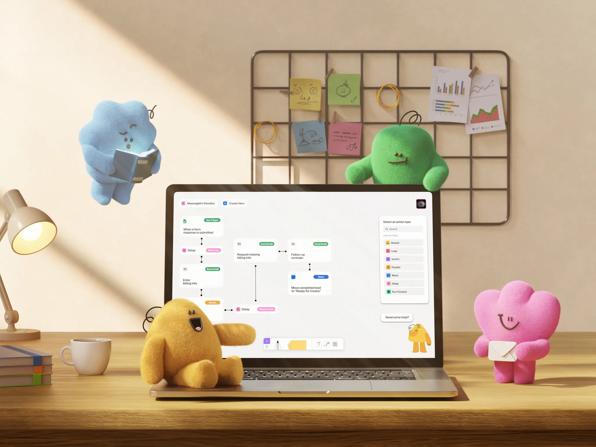

# Nyuman · 毛绒数字同事与工作流画布的品牌连接

| 产品名 | 链接 | 收录时间 | 产品场景 | 平台 | 标签 |
| --- | --- | --- | --- | --- | --- |
| Nyuman | [Dribbble 原文](https://dribbble.com/shots/27839057-Nyuman-3D-Character-Design-Digital-Workspaces) | 2026-10-29 | 工作流自动化 | Web（品牌展示图） | 3D 角色、数字同事、毛绒材质、工作流、帮助入口 |

## 素材与分析范围

依据：用户提供的 2000 × 1500 静态图，以及 Dribbble 作者说明（2026-10-29 访问）。作者为 Ivan Ermakov / Moonsight® Agency。分析对象是角色与数字工作空间的组合展示，未体验产品。

作者将 Nyuman 描述为由 Yoom 转型而来的日本 AI 自动化平台，四个角色分别承载运营、应用连接、通信和信息分析的职责。本次没有旧版素材，不能据此判断具体界面改版。没有收到其他已有分析，以下是本次截图观察。

## 视觉风格总览

**一句话**：用暖色实物办公桌、四种可辨识的毛绒轮廓包围白色流程画布，并让黄色角色在界面帮助入口再次出现。

| 维度 | 可比较的特征 |
| --- | --- |
| 基调 | 米色墙面、木桌、斜向日光建立居家办公场景；彩色角色提供焦点，屏幕维持低彩度 |
| 配色 | 原页面提供的画面调色板包括 #EDE8E0、#EFD7B3、#917151、#5E3F24；这些是作品配色参考，不是产品设计 token |
| 角色颜色 | 蓝、绿、黄、粉分配到四个角色；截图视觉估测参考分别为 #A0C9DE、#6EC56B、#E5B83F、#ED8DBA，受光照和毛绒纹理影响，非精确固有色 |
| 形状 | 蓝色多瓣、绿色圆顶、黄色近三角、粉色花瓣轮廓；共同使用短粗肢体、小五官、无尖角躯干 |
| 深度 | 绒毛微表面 + 地面接触阴影 + 前后遮挡；笔记本与墙上金属网格是硬质直线骨架，角色形成软硬对照 |

## 字体

| 角色 | 字体 | 证据与限制 |
| --- | --- | --- |
| 品牌标题 | 未展示 | 画面没有独立大标题，不能从 Dribbble 网页字体代推品牌字体 |
| 正文 / UI | 拉丁无衬线，具体字体待确认 | 节点说明和右侧菜单可见，但透视与缩放不足以识别字体家族 |
| 标签 / 元信息 | 无衬线，字体待确认 | 绿色、粉色胶囊内使用更小的文字 |
| 数字 / 等宽 | 未确认 | 未看到足以确认等宽字体的样本 |

- **字号阶梯**：标签小于节点正文，菜单标题与正文接近；无展示型大字。原始 CSS 字号待确认，截图像素不能当作界面字号。
- **字重与行高**：正文视觉近 Regular，标签和部分标题略重；400 / 500 只能作为候选，不能确认为实际值。行高未能测定。
- **启发**：主画面靠轮廓、色块、遮挡建立识别，屏内文字负责操作说明，两套层级分工清楚。

## 层级结构

- **整张构图**：背景墙网格与便签 → 中景电脑和绿色角色 → 前景黄色、粉色角色及桌面物件。蓝色角色处于左上留白区，四角分布包围屏幕。
- **画面比例**：屏幕约占画面宽度的四成多，位于下半部；黄色角色遮挡屏幕左下区域。适合品牌展示，作为功能说明图则有信息损失。
- **屏内布局**：左上项目名与 Create New；中部节点连线；右侧 Select an action type 浮层；底部工具栏；右下帮助角色。
- **节点层级**：应用图标与动作胶囊在上，动作说明在下；连接点和细线表达关系。节点文字是业务内容，胶囊颜色是动作分类线索。
- **信息架构边界**：只能确认当前画布分区，无法推断完整导航、项目管理层级或移动端结构。

## 视觉要点

- **角色识别有三层冗余**：颜色、外轮廓、道具。即使移除颜色，阅读的蓝色角色与持信封的粉色角色仍有不同语义。
- **材质统一而轮廓不同**：四个角色都用短绒、圆肢体、细线表情，形成家族；并非仅把同一个模型换色。
- **道具表达职责**：书本指向信息阅读，信封指向通信；墙上的图表和便签补充办公语境。具体角色名与图中颜色的对应未独立核实。
- **照明组织视线**：左上高亮墙面与斜向明暗分界把注意力带向中央；角色脚下和电脑底部较深的接触阴影避免漂浮感。
- **屏内外复杂度分工**：外部场景纹理密集，屏内卡片接近白色、连线细、阴影轻；右侧动作面板用较明显的边界与阴影抬升层级。

## 交互设计点

| 观察到的元素 | 可确认内容 | 尚未验证 |
| --- | --- | --- |
| 流程节点 | 表单触发、邮件、Delay、Branch、Move 等标签与连接线 | 执行顺序、分支条件和实际运行效果 |
| 动作选择面板 | 搜索框，以及 Branch / Loop / Switch / Parallel / Move / Delay / Run Flowbot 菜单项 | 搜索结果、选择后插入方式 |
| 底部浮动工具栏 | 选择、书写、便签、文本等视觉符号 | 拖拽、快捷键、缩放行为 |
| 帮助入口 | 黄色小角色上方出现 “Need some help?” 气泡 | 是否可点击、是否 AI 对话、关闭方式与触发条件 |
| 状态与动效 | 当前仅有静态展示 | 加载、空、错误、成功状态，以及动画、转场均未验证 |

### 屏内外角色呼应

前景黄色毛绒角色在屏幕右下以简化的小形象复现：品牌形象从外部叙事进入帮助入口。这提供了一种可借鉴的定位方法——用角色帮助用户认出支持入口。它是否能提高发现率、是否干扰工作，需要实际使用验证；不能仅凭气泡断言其具备智能协作能力。

## 演变时间线

| 时间 | 变化 / 记录 | 类型 | 证据 |
| --- | --- | --- | --- |
| 时间未注明 | 作者描述 Yoom → Nyuman 转型，并引入四位数字同事 | 品牌 | Dribbble 作者说明，尚无前后对照图 |
| 2026-10-29 | 首次收录角色与流程界面同框展示 | 收录基线 | 用户截图；日期不是产品发布日期 |

**后续观察**：收集原生界面截图，确认角色是否持续出现在帮助、引导、错误或执行完成状态；获取旧版素材后再比较品牌变化。

## 可借鉴 / 待商榷

- 可借鉴：多角色用轮廓和道具共同区分职责；毛绒材质和光照统一家族；角色在品牌展示与帮助入口保持识别连续性。
- 待商榷：前景角色遮住节点；宣传图中的小字不适合阅读功能细节；多色角色不应直接等同于成功/错误等状态色。
- 落地建议（非已实现功能）：帮助角色应可收起，避开画布操作区；若增加动效，应尊重减少动态效果设置。

## 关联与对比

| 对比对象 | 共同触点 | 差异与证据边界 |
| --- | --- | --- |
| [heypcb](../2026-10-27-heypcb/README.md) | 画布与辅助入口 | heypcb 已有分析记录常驻 AI 对话、计划与批准；Nyuman 本图只见角落帮助气泡，无法比较其真实能力 |
| [WayPilot](../2026-10-26-WayPilot/README.md) | 品牌叙事连接产品界面 | WayPilot 以字体混排、光晕和输入框演示组织官网；Nyuman 以角色、道具和空间构图组织品牌展示，两者证据形态不同 |
| [FLOX](../2026-10-26-FLOX/README.md) | 3D 质感与低彩度界面 | FLOX 的 3D 质感局限于局部卡片；Nyuman 将其扩为包围界面的环境，适合品牌记忆，不能直接照搬到高密度工作界面 |

归纳见 [SUMMARY.md](../../../SUMMARY.md)。后续需补原生 UI、字体样式与交互录屏，才能深化产品可用性结论。
