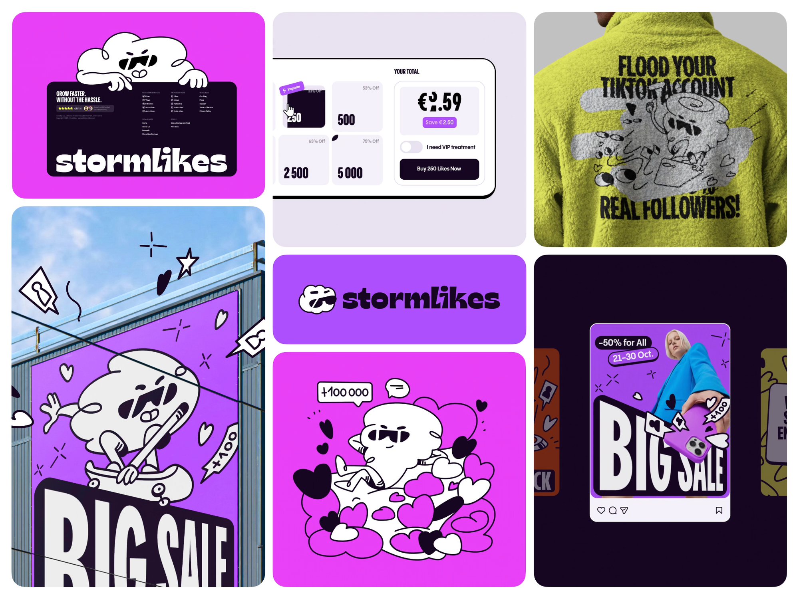

# Stormlikes · 云朵角色、窄体标题与跨媒介品牌系统

| 产品名 | 链接 | 收录时间 | 产品场景 | 平台 | 标签 |
| --- | --- | --- | --- | --- | --- |
| Stormlikes | [Dribbble 原文](https://dribbble.com/shots/27422066-Stormlikes-Bento-Identity-Campaign-Visual-System) | 2026-10-29 | 品牌与营销传播 | Web / 社交媒体 / 户外 / 服装展示 | 品牌系统、Bento 展示、2D 吉祥物、窄体标题、色块、跨媒介 |

## 素材与范围

用户提供 2000 × 1500 静态截图，确认无已有报告。补充来源为 Moonsight® Agency 的 Dribbble 项目说明（2026-10-29 访问）：作品展示统一视觉系统在网页、社交与户外传播中的应用。以下主要是截图观察；不是对已上线产品的体验评测，也不将展示中的营销宣称当作已核实效果。

## 视觉风格总览

**一句话**：用紫粉高彩度色块、白色云朵角色和近黑粗线建立识别，把横向粗字标与纵向窄体标题组合应用到不同媒介。

| 维度 | 可比较细节 |
| --- | --- |
| 基调 | 大色块与大字优先，黑白线稿负责造型；小心形、闪光、对话框构成社交符号词汇 |
| 配色 | 原页面作品调色板含 #ECE8F1、#060307、#C410ED、#FBFD14；不是已验证的 UI token |
| 截图参考色 | 紫色约 #A449F5、亮粉约 #E32EF1、深紫黑约 #16051F，均为视觉估测；服装黄绿受材质和光照影响，不能用页面调色板替代实物色 |
| 形状语言 | 外层展示块大圆角；内部云朵多瓣、心形、波浪线、星芒与倾斜标签；UI 内仍以规则矩形和胶囊为主 |
| 深度 | 2D 黑色硬偏移阴影、贴纸叠压、海报透视；摄影和服装纹理承担真实材质，插画本身保持平涂 |

## 字体

| 角色 | 字体判断 | 可确认特征 |
| --- | --- | --- |
| stormlikes 字标 | 具体字体待确认，可能含定制字形 | 小写、极粗、横向紧密、局部切角与斜向处理；不应直接当作可用于正文的字体 |
| BIG SALE / 服装标题 | 具体字体待确认 | 大写、极窄、强纵向拉伸感；黑底白字和浅底黑字均有使用 |
| 购买数量与金额 | 具体字体待确认 | 粗窄数字强调数量与价格；货币符号参与同一强层级 |
| UI 正文 / 按钮 | 无衬线，具体字体待确认 | 字面宽度较正常，保证短标签与按钮可读；未见足够证据确认字体家族 |

- **字号阶梯**：广告标题最大，字标次之，购买金额与数量是组件内一级；折扣、VIP 标签、按钮文案再降一层。各媒介单独建立阶梯，不能把拼贴内的相对大小换算为统一 CSS px。
- **字重**：字标与广告标题视觉近 Black / Heavy，正文近 Regular / Medium；具体数值、行高、字距均待设计源或页面样式确认。
- **层级策略**：字标用宽与厚形成横向品牌锚点，促销标题用窄与高在竖幅中放大；正文承担操作解释。

## 层级结构

- **展示拼贴**：三列近等宽，纵向分块不等高。以 2000px 原图估测，左右外边距约 30px，列间约 20px，展示块圆角约 35px；这是导出图几何，不是网页布局规格。
- **左列**：上方网页/页脚展示与云朵探头，下方大幅户外广告；中列为购买面板、字标条、插画；右列为服装背面和社交广告。
- **品牌资产层**：同一云朵形象可化为字标旁小图标、页面边缘探头角色、滑板动作角色和插画主角。
- **购买面板层**：左侧数量选项网格，右侧总价、节省金额、VIP 开关、购买 CTA；当前选项深色反转，其他选项浅紫底。
- **促销海报层**：折扣/日期标签在上，人物摄影居中，BIG SALE 在下；手机、心形与小贴纸跨越元素边界，增加前后关系。
- **架构边界**：只有片段，无法判断网站完整导航、支付步骤或响应式行为。右下并排露出的卡片不构成“可滑动轮播”的证据。

## 视觉要点

- **大圆角是展示容器，粗线是品牌语法**：不要把整张 Bento 拼贴误读为 Stormlikes 的产品首页布局。
- **跨媒介保持不变量**：角色轮廓、黑白描边、窄体大标题与紫粉色块反复出现；每个媒介再改变比例、摄影、裁切与背景。
- **功能区主动降噪**：购买面板改用浅紫/白底，深色选中卡与 CTA 聚焦行动，高彩度主要用于折扣和推荐小标签。
- **硬阴影延续插画风格**：购买外框底部出现黑色偏移边，而不是弥散柔影，与插画粗线形成一致性。
- **实物与平面叠合**：服装绒面保留材质，人物与手机摄影进入海报；角色仍保持平面线稿，避免所有元素都做成立体渲染。
- **装饰符号与信息符号相邻**：心形、对话框既是品牌装饰，也与社交界面图标相似；实际交互页面需区分装饰与可点击控件。

## 交互设计点

| 静态可见 | 设计含义（观察/推断分开） | 待验证 |
| --- | --- | --- |
| 250 / 500 / 2500 / 5000 数量卡片 | 深色卡呈现选中态，浅色卡呈现其他选项 | 点击后金额是否更新、键盘操作、选中态语义 |
| Popular 斜贴纸、折扣文字 | 推荐与优惠层级叠在数量卡上 | 推荐依据、折扣计算与有效期 |
| YOUR TOTAL + Save 标签 | 总价与节省金额在右侧集中，减少视觉搜索 | 税费、附加费、价格更新规则 |
| I need VIP treatment 开关 | 视觉上为关闭态，位于价格和 CTA 之间 | 开启是否加价、服务差异、解释入口 |
| Buy 250 Likes Now | 按钮文案包含当前数量，连接选择与提交 | 支付确认、加载、成功、失败与退款流程 |
| 社交帖子底部图标 | 展示借用了社交平台的操作语境 | 是否为真实可交互组件 |

动效、hover、转场、手势和快捷键没有视频或原生页面证据，均未验证。

### 可借鉴的购买组件分工

数量负责选择，总价负责结果，按钮文案重复数量负责最终核对。截图呈现了这种信息分工，但没有证明选项与价格确实联动。若用于实际方案，应把附加选项的价格影响解释清楚，并保留稳定的价格反馈位置。

## 演变时间线

| 时间 | 记录 | 类型 | 影响 / 限制 |
| --- | --- | --- | --- |
| 2026-10-29 | 首次收录同一品牌的多媒介展示 | 收录基线 | 可比较跨媒介一致性，不能推断历次改版 |

没有历史素材，暂无纵向变化结论；后续可收集旧字标、旧购买页与新活动海报，比较品牌资产保留与功能界面变化。

## 可借鉴 / 待商榷

- 可借鉴：保留少量稳定资产，再用尺寸、裁切和动作制造变体；角色在大插画与小标识中都可识别；营销高彩度在购买组件中收敛。
- 待商榷：窄体大写适合短标题，长句会挤压辨识空间；服装上文字与插画相交影响阅读；页面小字在展示缩图中无法评估对比度。
- 待商榷：促销标签、角色和超大字同时出现时容易争抢注意力，真实购买页应优先保留价格、数量和条款的可读性。

## 关联与对比

| 对象 | 共同点 | 差异 |
| --- | --- | --- |
| [Nyuman](../2026-10-29-Nyuman/README.md) | 品牌角色与数字界面建立关联 | Nyuman 四种毛绒角色以材质、道具分工；Stormlikes 同一云朵角色以动作、线稿和色块跨媒介复用 |
| [FLOX](../2026-10-26-FLOX/README.md) | 不等高矩形分区 | FLOX 的 Bento 是产品内数据组织；本图的 Bento 是案例陈列，两者不应当作同一种交互布局比较 |
| [WayPilot](../2026-10-26-WayPilot/README.md) | 字体对比与品牌符号进入营销内容 | WayPilot 用无衬线/衬线混排与柔光；Stormlikes 用宽粗字标/窄体大写对比、硬边色块与线稿 |

归纳见 [SUMMARY.md](../../../SUMMARY.md)。字体文件、原生购买页与交互状态截图是后续补充重点。
